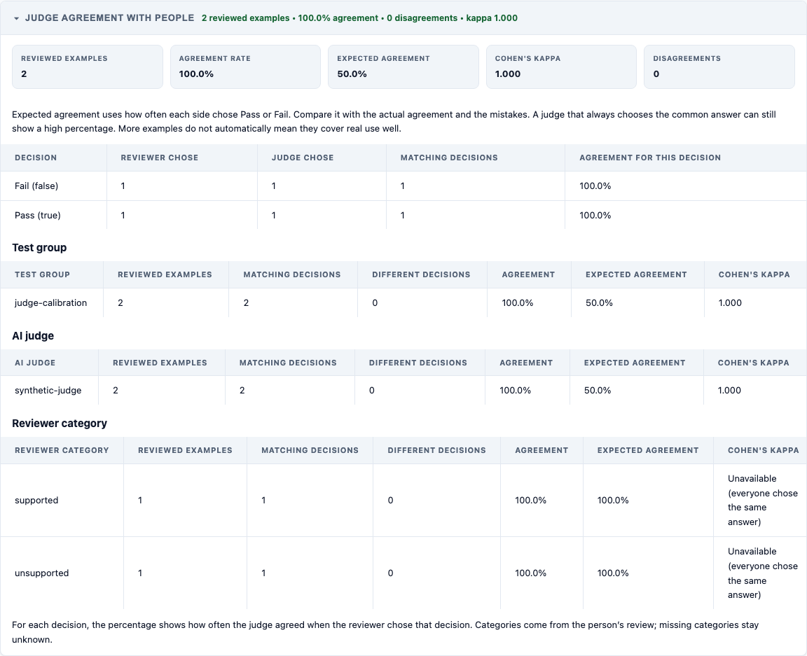

# Check whether an AI judge agrees with people

An AI judge is a model that marks an answer as passing or failing. This view
compares its decisions with a person's reviewed answers. The feature is in
source after version 0.11.0.

## Start with the mistake

A person reviews ten answers: nine should pass and one should fail. The judge
says “Pass” for all ten. It matches the person nine times, so agreement is 90%.
But the judge missed the only bad answer.

The report adds Cohen's kappa, an agreement score that accounts for how often
each answer is used. In this example it is zero. That helps expose the weakness
hidden by the high agreement percentage.

## What the report shows

- **Reviewed examples:** examples with both a judge decision and a person's
  answer. Missing either decision means the example does not count.
- **Agreement:** the percentage of decisions that match.
- **Expected agreement:** agreement calculated from how often each side chose
  Pass and Fail. This is a supporting calculation, not a minimum set by the team.
- **Cohen's kappa:** the extra agreement score, read alongside the percentage
  and the example count.
- **Decision counts:** how often the judge and the person each chose Pass or
  Fail, and how often they agreed for each choice.
- **Results by test group, judge and reviewer category:** where agreement is
  better or worse. A test group is called a `suite` in the report file.

A score alone is not proof that a judge is accurate. More examples do not
necessarily cover real use well, and people can make labelling mistakes too.
Review the examples where the decisions differ.

## When a score cannot be calculated

If there are no examples with both decisions, agreement and kappa are unknown.
If everyone always chooses the same answer, agreement is 100% but kappa cannot
be calculated. The report shows “Unavailable”; it does not invent a score.

For example, ten Pass decisions from both sides show that those decisions
match. They do not show how the judge handles a Fail decision.

## Try the report

Run this from the repository root:

```sh
pnpm dev report --input=examples/calibration-minimum-sample --report-dir=./calibration-report --reporter=html --reporter=json-summary
```

The demonstration has two matching decisions: one Pass and one Fail. Both
agreement and kappa are one. These two examples explain the display; they do
not establish production reliability.



Regenerate this image with `pnpm assets:regenerate`.

The text and HTML views show at most 20 groups for each breakdown and say when
more exist. The JSON output includes all groups.

## Require a minimum result

Displaying the score does not turn on a new check. To require a result, add
these settings to a test group's `gate.thresholds` and run `check`:

```json
{ "minJudgeAgreementRate": 0.9, "minCalibrationRows": 20, "minJudgeKappa": 0.6 }
```

This asks for at least 90% agreement, 20 complete comparisons and kappa 0.6.
The values are illustrations, not recommended defaults. Choose requirements
for your task and the mistakes you need to catch.

The kappa minimum must be a number from -1 to 1. `min_judge_kappa` and
`min-judge-kappa` are alternative spellings. If the required score is missing
or too low, the check fails. A test group used only for reporting does not
block the run.
The check compares the actual decision counts with your chosen minimum.
It does not use a rounded display value or allow a lower score to pass.

When a previous report is used to show that a judge has passed review, the
minimum must pass on that judge's own examples. Another judge's results cannot
improve its score. The existing age limits, requirement for a separate run,
matching versions of the scoring rules and explicit warning-only choices still
apply. Publishing a report does not itself run these checks.

## Read the results from code

Use `analyzeRun(report).calibration` or `summarizeCalibration(report.rows)`.
JSON summaries and the readable reports use the same calculation.
Readable reports show this section when judge decisions or a human review
test group are present. JSON always includes the count and status, even when
there are no comparisons.

The report file uses `judgeVerdict` for the judge's decision and
`groundTruthVerdict` for the person's answer. `true` means Pass and `false`
means Fail. Two Fail decisions count as agreement.

Category groups use `groundTruthCategory`, supplied with the person's review.
Missing category or judge names remain unknown. Failure categories in
`row.category` are kept separate from these answer choices. Support for more
than two answer choices is a later roadmap item.

The public types are `CalibrationAgreement` and `CalibrationSummary`.
`kappaStatus` is `defined`, `no-pairs` for missing comparisons, or `degenerate`
when everyone used the same single answer. Unavailable numbers use `undefined`
in code, so JSON omits those numeric fields and keeps the status and counts.

## How kappa is calculated

This is unweighted Cohen's kappa for the two Pass/Fail choices:

`(observed agreement - expected agreement) / (1 - expected agreement)`

Observed agreement is the fraction of decisions that match. Expected agreement
uses how often each side chose Pass and Fail. This is the definition documented
by [scikit-learn](https://scikit-learn.org/stable/modules/generated/sklearn.metrics.cohen_kappa_score.html).
No Python package or other dependency is added.

Each group's score uses its own examples. A small group, or one where everyone
used the same answer, may have no usable kappa score. Kappa is not a confidence
interval and does not prove that examples are independent of one another.
