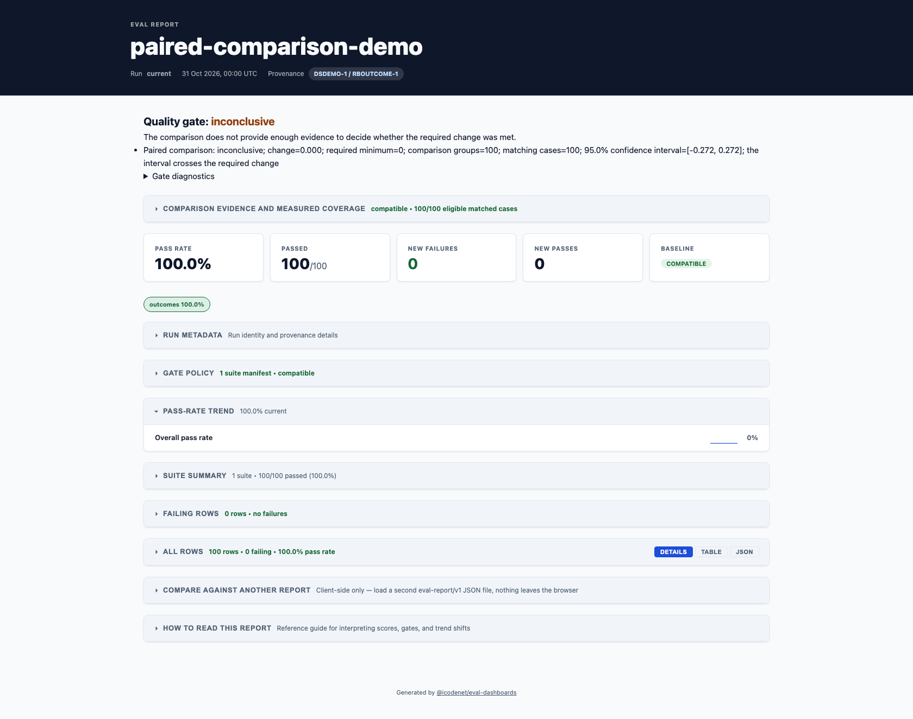

# Gates

Gates make eval quality enforceable in CI.

## Reported gate decisions

`eval-dashboards report` evaluates the same resolved policy as `check` for the
same full-run inputs, baseline selection, and configuration. This includes
blocking suite manifests, calibration, configured waivers, and threshold-change
checks. Put shared policy in the config file; check-only CLI overrides and
`--tier` budgets do not automatically carry over to a separate report command.

HTML, Markdown, text, and `summary.json` expose `gateDecision` (`passed`, `failed`,
`inconclusive`, or `not-evaluated`) with failures and diagnostics. The opt-in
paired gate can produce an inconclusive decision. `check --json-out` and
`--json-v2-out` include the same additive decision field. Report generation
still exits `0` when a report is written even if gates fail; use `check` for CI
exit `1`. Invalid policy inputs exit `2`.

Programmatic `renderReports` callers may supply a completed `gateDecision`,
using the exported `gateDecisionFromResult` helper. The helper converts a supplied result; it does not execute policy checks. Callers are responsible for supplying the completed evaluation for the same report and baseline. Omitting it renders
`not-evaluated`, even with a high pass rate. The helper copies evidence arrays
and treats inconsistent passing results with failures as failed. A decision
is scoped to its evaluated artifacts, policy, and baseline; it is not a hosted
authorization or release approval record.

Pass-rate numbers and suite summary headings no longer use fixed 90%/60%
thresholds to suggest policy approval. Baseline comparison without evidence is
neutral. Row pass/fail evidence remains visible independently of gate policy.
This is part of M1. Matching-case and missing-data semantics are described in
[history storage](./history-storage.md#matched-cohorts-and-measured-telemetry);
trial-level evidence and uncertainty remain open.

## Why This Matters

- Preflight failures should block expensive stages early, before noisy live/judge failures hide root cause.
- Regressions should be counted once per logical failure, not multiplied by axis or mirrored rows.
- Warnings should be treated as explicit quality debt, not ignored until they become production incidents.
- Baseline compatibility should prevent misleading comparisons across dataset/rubric drift.

## What Changed

- Added warning gates: `maxWarnings`, `maxWarningsByCode`, `failOnWarningCodes`.
- Added canonical new-failure keying via `newFailureKey`.
- Added required suite-pass enforcement via `requiredPassingSuites`.
- Preserved baseline-aware controls (`baseline-run-id`, `baseline-strategy`, `baseline-lookback`, `allow-blocked-baseline`).

## How To Apply

- Add gate policy defaults in `eval-dashboards.config.ts`.
- Override policy per pipeline using `eval-dashboards check` flags.
- Prefer `require-suite-pass=preflight` for live workflows.
- Use `new-failure-key=scenario-category` when one scenario can emit multiple rows.
- Add warning budgets for the highest-risk warning codes first.

Initial gates:

- `minPassRate`
- `maxNewFailures`
- `zeroCritical`
- `maxCriticalFailures`
- `criticalFailureRate`
- `minJudgeAgreementRate`
- `maxJudgeDisagreementRate`
- `maxAxisScoreDelta`
- `maxWarnings`
- `maxWarningsByCode`
- `failOnWarningCodes`
- `requiredPassingSuites`
- `newFailureKey`
- `statistical.mode` (`off` or `bootstrap`)
- `statistical.confidenceLevel`
- `statistical.bootstrapSamples`
- `statistical.minPassRateDelta`
- `repeat.runs` / `repeat.requiredPasses` (4F.23)

## PR-subset vs full-suite tiering with a cost budget (4F.10)

Tag suites in their manifest with `tier: 'pr' | 'full' | 'both'` (default `both`
when omitted, so untagged suites always participate — tiering is opt-in per
suite, never opt-out). Then gate only one tier:

```sh
eval-dashboards check --input=.evals_output --tier=pr --max-pr-cost-usd=2 --max-pr-duration-ms=300000
```

- `--tier=pr|full` filters the report to that tier's suites/rows before any
  other gate runs (pass rate, new-failure count, warnings, etc. are all
  computed on the filtered subset).
- `--max-pr-cost-usd` fails the gate when the tier's summed row
  `usage.costUsd` exceeds the budget. When canonical usage cost is absent,
  legacy `metadata.costUsd` / `costUSD` / `usdCost` / `cost.usd` /
  `pricing.costUsd` aliases are read as fallbacks. A row is counted once.
- `--max-pr-duration-ms` fails the gate when the tier's summed row
  `durationMs` exceeds the budget.
- `check --json-out`/`--json-v2-out` always includes a `prTier` object
  (`{ tier, suiteCount, rowCount, totalCostUsd, totalDurationMs,
  rowsMissingCost }`) whenever `--tier` is passed, so "the PR gate is under
  budget" is a checkable number rather than an unstated assumption.

Intended workflow: keep a cheap, fast `pr`-tier subset gating every PR under
an explicit budget, and run the full suite (including `full`-tier suites) on
a schedule — instead of moving the whole gate to nightly and losing PR-time
protection.

Example:

```sh
eval-dashboards check --input=.evals_output --min-pass-rate=0.9 --max-new-failures=0 --zero-critical
```

Machine-readable CI output:

```sh
eval-dashboards check --input=.evals_output --max-new-failures=0 --zero-critical --json-out=eval-report/check-result.json
eval-dashboards check --input=.evals_output --max-new-failures=0 --zero-critical --heartbeat-out=eval-report/check-heartbeat.json
eval-dashboards check --input=.evals_output --max-new-failures=0 --zero-critical --junit-out=eval-report/check-result.junit.xml
eval-dashboards check --input=.evals_output --max-new-failures=0 --zero-critical --sarif-out=eval-report/check-result.sarif.json
eval-dashboards check --input=.evals_output --max-new-failures=0 --zero-critical --github-annotations-out=eval-report/check-annotations.json
```

`check-result.json` includes `newlyFailingRows[]` with URL-safe `reportAnchor` values (`#row-<encodeURIComponent(suite:id)>`) so CI annotations can deep-link directly to row evidence in the generated HTML report.

`check-heartbeat.json` includes machine-readable run status (`ran`, `skipped`, or `errored`) so CI can alert when gate execution did not run cleanly.

Heartbeat payload contract (`eval-check-heartbeat/v1`):

- `schemaVersion`: `"eval-check-heartbeat/v1"`
- `gateRunStatus`: `"ran" | "skipped" | "errored"`
- `generatedAt`: ISO timestamp for when heartbeat was written
- `exitCode`: check command exit code
- `runId` (optional): run id when available
- `baselineRunId` (optional): selected baseline run id when available
- `message` (optional): failure message for skipped/errored runs

- `--junit-out` emits JUnit XML for test-report ingestion in CI systems.
- `--sarif-out` emits SARIF 2.1.0 JSON with stable report-file locations plus row-anchor metadata (`properties.reportAnchor`).
- `--github-annotations-out` emits a simple annotations JSON payload (`level`, `title`, `message`) that workflow helpers can translate into GitHub log annotations.
- `--step-summary-out=<path>` appends a Markdown summary (verdict, gate failures, newly failing rows, diagnostics) to a file. Pass `$GITHUB_STEP_SUMMARY` to show it on the workflow run page. Failure text is escaped, because it can echo model output.
- `--heartbeat-out` emits gate-run heartbeat JSON (`eval-check-heartbeat/v1`) with `gateRunStatus`, `exitCode`, and optional error message.

### 4F.7 Heartbeat verifier (scheduled absence detection)

`--heartbeat-out` (above) only proves the gate ran *this run*. It cannot detect a
release where the gate step itself was deleted or skipped from the pipeline
entirely — in that case nothing ever writes the heartbeat file, and nothing on the
release path notices. `eval-dashboards heartbeat-verify` closes that gap: run it on
its own schedule, independent of the release pipeline, pointed at wherever each
release's heartbeat is published:

```sh
eval-dashboards heartbeat-verify --heartbeat=eval-report/check-heartbeat.json --max-age-hours=24
```

- Exit `0`: a heartbeat file exists, is valid JSON, reports `gateRunStatus: "ran"`, and its `generatedAt` is within `--max-age-hours`.
- Exit `1`: the heartbeat is missing, unparseable, stale, or reports `gateRunStatus` of `skipped`/`errored` — this is the alert signal for a deleted/skipped gate step.
- Exit `2`: required flags (`--heartbeat`, `--max-age-hours`) are missing or invalid.

Wire it as its own scheduled workflow (e.g. a periodic GitHub Actions cron job, unrelated to the release workflow) that reads the heartbeat published/copied out of the release pipeline (e.g. as a build artifact, or committed/published alongside the report). A non-zero exit from this job is the alert: absence of evidence becomes detectable instead of silently passing.

Notification adapters (opt-in):

- `--notify=<channel>` enables one or more channels (`slack`, `teams`, `email`) when a blocking gate fails or baseline compatibility is blocked.
- `--notify-webhook=<url>` sets a shared webhook URL fallback for Slack or Teams.
- `--notify-slack-webhook=<url>` and `--notify-teams-webhook=<url>` set channel-specific webhook URLs.
  - Teams notifications are sent as Adaptive Card webhook payloads.
  - When both `slack` and `teams` are enabled, provide channel-specific URLs (shared webhook fallback is rejected).
- `--notify-email-smtp=<url>`, `--notify-email-from=<address>`, `--notify-email-to=<address>` configure SMTP email notifications.
- `--notify-report-link=<url-or-path>` overrides the link/path included in payloads (default: `<report-dir>/index.html`).
- `--calibration-suite=<id>` overrides the calibration evidence suite id (default: `judge-calibration`).
- `--calibration-max-age-hours=<n>` sets recency window for calibration evidence (default: `168`; must be finite and `> 0`).
- `--calibration-preflight` force-enables calibration preflight checks.
- `--allow-stale-calibration` is the escape hatch: missing/stale calibration evidence is downgraded to diagnostics instead of failing blocking suites.
- `--no-calibration-preflight` disables calibration preflight checks.
- Environment fallbacks are supported for CI secret hygiene: `EVAL_NOTIFY_CHANNELS`, `EVAL_NOTIFY_WEBHOOK`, `EVAL_NOTIFY_SLACK_WEBHOOK`, `EVAL_NOTIFY_TEAMS_WEBHOOK`, `EVAL_NOTIFY_SMTP_URL`, `EVAL_NOTIFY_EMAIL_FROM`, `EVAL_NOTIFY_EMAIL_TO`, `EVAL_NOTIFY_REPORT_LINK`.
- Notification delivery is best-effort: send failures/skips are captured in `check-result.json` (`diagnostics` and optional `notifications`) when `--json-out` is enabled, but do not change check exit codes.

Security note: prefer environment variables or config-file references for webhook/SMTP secrets. Avoid putting secret URLs directly in CLI flags in shared CI logs.

Example:

```sh
eval-dashboards check \
  --input=.evals_output \
  --max-new-failures=0 \
  --zero-critical \
  --notify=slack \
  --notify-webhook="$SLACK_WEBHOOK_URL" \
  --notify-report-link="https://example.github.io/my-repo/eval-report/index.html"
```

Config file equivalent:

```ts
export default {
  notifications: {
    channels: ['slack', 'teams', 'email'],
    reportUrl: 'https://example.github.io/my-repo/eval-report/index.html',
    slack: { webhookUrl: process.env.SLACK_WEBHOOK_URL },
    teams: { webhookUrl: process.env.TEAMS_WEBHOOK_URL },
    email: {
      smtpUrl: process.env.EVAL_SMTP_URL,
      from: 'eval-bot@example.com',
      to: ['oncall@example.com'],
    },
  },
};
```

CI heartbeat guard example:

```sh
rm -f eval-report/check-heartbeat.json eval-report/check-result.json

# run check ... --heartbeat-out=eval-report/check-heartbeat.json --json-out=eval-report/check-result.json

if [ ! -f eval-report/check-heartbeat.json ]; then
  echo "Eval check heartbeat output missing"
  exit 1
fi

status=$(jq -r '.gateRunStatus' eval-report/check-heartbeat.json)
exit_code=$(jq -r '.exitCode' eval-report/check-heartbeat.json)

if [ "$status" != "ran" ]; then
  echo "Eval check did not run cleanly (status=$status)"
  exit 1
fi

if [ "$exit_code" != "0" ] && [ "$exit_code" != "1" ]; then
  echo "Eval check errored (exitCode=$exit_code)"
  exit 1
fi

if [ "$exit_code" = "1" ]; then
  echo "Eval gates failed"
  exit 1
fi

if [ ! -f eval-report/check-result.json ]; then
  echo "Eval check result output missing"
  exit 1
fi
```

Warning-aware gate options:

- `--max-warnings=<n>`: fail if taxonomy warnings exceed budget.
- `--max-warning-code=<code>:<n>` (repeatable): per-warning-code budgets.
- `--fail-on-warning-code=<code>` (repeatable): hard-fail selected warning classes.

Canonical new-failure keys:

- `--new-failure-key=row` (default): suite + row id.
- `--new-failure-key=scenario`: suite + scenario id.
- `--new-failure-key=scenario-category`: suite + scenario + category.
- `--new-failure-key=id-category`: suite + row id + category.

Preflight suite enforcement:

- `--require-suite-pass=<suite-id>` (repeatable): fail when a required suite has any failing rows.

Mandatory calibration preflight for judge-scored suites:

- Applies when the current artifact includes the configured calibration suite manifest (default: `judge-calibration`), or when force-enabled via `--calibration-preflight` / `gates.calibration.enabled: true`.
- Runs on judge-scored suites in the current artifact (`llm-judge` / `human-labelled-calibration` graders), excluding the calibration suite id itself.
- Check requires a calibration evidence run within the recency window whose calibration rows include matching `judgeModel` and `groundTruthVerdict`.
- Rubric matching is evaluated against the calibration suite rubric contract (`judge-calibration`), not each target suite manifest rubric.
- Blocking suites require independent evidence: current-run calibration rows do not satisfy blocking gate checks.
- Report-only suites may self-certify against current-run calibration rows (diagnostic signal, not blocking enforcement).
- If a matching recent calibration run is missing:
  - `gate.mode=blocking`: check fails by default.
  - `gate.mode=report-only`: check emits a loud diagnostic warning.
- Suites that do not emit `judgeModel` values fail in `blocking` mode (unless `--allow-stale-calibration` is set), and emit warning-only diagnostics in `report-only` mode.
- Escape hatch: `--allow-stale-calibration` (or `gates.calibration.allowBlockingWithoutRecentMatch: true`) downgrades blocking failures to warnings.
- Force-enable path: `--calibration-preflight` (or `gates.calibration.enabled: true`).
- When the current artifact includes the configured calibration suite manifest, that suite must include rubric metadata (`rubricVersion` in suite manifest or rubric contract).
- Missing calibration rubric metadata in that case is treated as invalid artifact/config input (exit code `2`).
- Disable path: `--no-calibration-preflight` (or `gates.calibration.enabled: false`).
- Conflicting flags (`--calibration-preflight` and `--no-calibration-preflight`) fail fast with exit code `2`.
- Breaking behavior change: blocking suites now require independent calibration evidence; same-run calibration rows no longer satisfy blocking checks.

Config file equivalent:

```ts
export default {
  gates: {
    calibration: {
      enabled: true,
      suite: 'judge-calibration',
      maxAgeHours: 168,
      allowBlockingWithoutRecentMatch: false,
    },
  },
};
```
- Typical usage: `--require-suite-pass=preflight` before live/judge gates.

Run selection:

- `--run-id=<id>`: the run `check` gates. Default: the latest run found in
  `--input`.

Baseline-aware options:

- `--baseline-run-id=<run-id>`: explicit baseline.
- `--baseline-strategy=rolling|champion`: choose baseline from discovered prior runs when `--baseline-run-id` is omitted.
- `--baseline-lookback=<n>`: restrict baseline candidates to the most recent `n` prior runs before strategy selection.

Automatic baseline selection only considers earlier runs that share at least one suite with the current run, and it skips calibration runs. A run of a different suite is never picked, because comparing across suites would report rows as new or disappeared when nothing changed. The lookback window counts only those runs. If no earlier run shares a suite, there is no baseline and every failing row counts as newly failing. Use `--baseline-run-id` to compare against a specific run on purpose. A run with no suites and no rows matches any earlier run.

Per-suite thresholds (`gates.suites` in the config file):

```js
export default {
  gates: {
    minPassRate: 0.8,
    suites: {
      safety: { minPassRate: 1, maxNewFailures: 0 },
      quality: { minPassRate: 0.9 },
    },
  },
};
```

- Each suite is held to its own bar, on top of the global gates. A suite can be stricter than the rest of the run.
- `minPassRate` is the suite's own pass rate. `maxNewFailures` counts newly failing rows of that suite only, using the same `newFailureKey` rule as the global gate.
- A suite named here that is missing from the run fails the gate, so a renamed or dropped suite cannot silently stop being checked.
- An unknown key inside a suite, such as `minPassRat`, exits with code 2.
- `--baseline-gate-config` also compares per-suite thresholds. Lowering a bar, raising a budget, or removing a suite's entry counts as a loosening.
- These are set in the config file only. There is no command-line flag.

Statistical gate options (opt-in):

- `--statistical-mode=off|bootstrap`: enable confidence-aware pass-rate delta gating (default `off`).
- `--confidence-level=<0..1>`: confidence interval level for bootstrap mode (default `0.95`).
- `--bootstrap-samples=<n>`: number of bootstrap resamples (integer, minimum `200`, default `2000`).
- `--min-pass-rate-delta=<n>`: minimum acceptable pass-rate delta vs baseline. The gate fails only when the bootstrap confidence interval is fully below this threshold (upper bound `< n`).

Current assumption: bootstrap draws are unpaired across all rows in each run (not scenario-paired resampling), and row counts must match between current and baseline runs. Use this as a conservative run-level signal, not a per-scenario statistical test.

### Repeat-run gate mode (4F.23)

When a runner emits `rows[].repeated` (the 4F.22 aggregation record — `{ runs, passes, aggregation }`, produced when a judge/case was actually run multiple times), `gate.repeat` lets you enforce a required pass count on those rows without a separate statistical engine — the gate only reads a field already in the artifact:

```ts
export default {
  gates: {
    repeat: { runs: 5, requiredPasses: 4 },
  },
};
```

```sh
eval-dashboards check --input=.evals_output --repeat-runs=5 --repeat-required-passes=4
```

- Only rows with a `repeated` record are checked; rows without one fall back to the existing pass-rate/threshold gates untouched.
- A row whose `repeated.runs` does not match the configured `runs` fails the gate (its aggregation record does not correspond to what was configured, so it cannot be judged against `requiredPasses`).
- A row whose `repeated.passes < requiredPasses` fails the gate.
- `requiredPasses` must be between `0` and `runs` inclusive; an out-of-range or non-integer config fails fast as an invalid gate config (same class of failure as other malformed gate config).
- Diagnostics report how many repeated-run rows were checked and against what `runs`/`requiredPasses`.


Typical workflow policies:

```sh
# Pull request policy: compare against previous run, tolerate blocked baseline compatibility while suites evolve.
eval-dashboards check --input=.evals_output --baseline-strategy=rolling --allow-blocked-baseline --max-new-failures=0 --zero-critical

# Main policy: compare against strongest recent same-mode run.
eval-dashboards check --input=.evals_output --baseline-strategy=champion --baseline-lookback=20 --max-new-failures=0 --zero-critical

# Strict live policy: require preflight pass and bound warning risk.
eval-dashboards check --input=.evals_output --require-suite-pass=preflight --new-failure-key=scenario-category --max-new-failures=0 --max-warnings=5 --max-warning-code=missing-kind:0 --fail-on-warning-code=missing-judge-model --zero-critical

# Statistical policy: require confidence that pass-rate delta is not regressing vs baseline.
eval-dashboards check --input=.evals_output --baseline-strategy=rolling --statistical-mode=bootstrap --confidence-level=0.95 --bootstrap-samples=2000 --min-pass-rate-delta=0
```

Waiver and exception register (`--waiver-file`):

- Records specific known failures (or a whole suite) that are allowed to ship despite failing gates, for a bounded time, with an audit trail — not a way to silently disable a gate.
- File format (`eval-waiver-register/v1`):

```json
{
  "schemaVersion": "eval-waiver-register/v1",
  "waivers": [
    {
      "id": "w-2026-09-15-safety-flake",
      "suite": "safety",
      "rowId": "prompt-injection-07",
      "reason": "Known judge miscalibration on this scenario, fix tracked",
      "riskOwner": "alice@example.com",
      "ticket": "JIRA-4821",
      "expiresAt": "2026-10-01T00:00:00.000Z"
    }
  ]
}
```

- `rowId` is optional; omit it to waive every currently failing row in `suite`.
- `--waiver-file=<path>` (or `waiverFile` in the config file) points `check` at the register.
- Matched, non-expired waivers cause their rows to be treated as passed and non-critical for gating, and their suite and new-failure counts are recomputed, so the waiver applies to `minPassRate`, `zeroCritical`, `maxNewFailures`, `requiredPassingSuites`, calibration checks and the rest. They are reported prominently as `ACTIVE WAIVER ...` diagnostics plus a `waivers.active[]` entry in `--json-out`/`--json-v2-out` payloads — an auditor reading only the check result sees exactly which known failures were carried and why.
- An **expired** waiver always fails the gate (`waivers.expired[]` + a `failures[]` entry), whether or not the underlying row still fails — the point of an expiry is that the risk must be re-reviewed, not silently extended.
- A waiver that matches no row in the current run (already-fixed or stale) is reported as a diagnostic only (`waivers.unmatched[]`), never a failure.
- A malformed or unreadable register file fails fast with exit code `2` (invalid config), same as other config errors.

Config file equivalent:

```ts
export default {
  waiverFile: 'eval-waivers.json',
};
```

Threshold-change detection / segregation of duties (`--baseline-gate-config`):

- Detects when the *resolved* gate configuration for this run (after config-file/CLI merge — exactly what `checkGates` enforces) is looser than a recorded baseline `GateConfig` JSON file, and fails the gate on any unapproved loosening. This prevents a PR from lowering its own bar (e.g. `minPassRate`) while introducing failures and passing on its own authority.
- `--baseline-gate-config=<path>` (or `baselineGateConfigFile` in the config file) points `check` at a plain `GateConfig`-shaped JSON file (e.g. checked into the repo and updated only via reviewed PR):

```json
{ "minPassRate": 0.9, "zeroCritical": true, "requiredPassingSuites": ["safety"] }
```

- Compared fields: `minPassRate`, `minMatchedExpectationRate`, `maxNewFailures`, `maxWarnings`, `maxWarningsByCode` (including budget removal), `zeroCritical`, `failOnBaselineBlocked`, `requiredPassingSuites` (removing a required suite is a loosening), `failOnWarningCodes` (removing a code is a loosening), `statistical.minPassRateDelta`, `statistical.confidenceLevel`, `calibration.enabled`, `calibration.maxAgeHours`, `calibration.allowBlockingWithoutRecentMatch`.
- A field present in only one of baseline/resolved config is not compared (no prior threshold to judge against).
- Any detected loosening fails the gate (`failures[]`) unless explicitly approved via `--allow-gate-loosening` (or `gates.allowLoosening: true` in the config file) — a reviewed, intentional relaxation — in which case it is still surfaced as a diagnostic instead of a failure.
- Always surfaced in `check --json-out`/`--json-v2-out` as `thresholdChanges: { loosened, allowed, changes[] }`, listing every changed field (loosened, tightened, or unchanged) with its baseline/resolved values, so the diff is visible in both console diagnostics and the machine-readable artifact even when a loosening was approved.

Fast preflight lint before expensive eval stages:

```sh
eval-dashboards lint --input=.evals_output
```

Use `--strict` to fail on warnings as well as errors:

```sh
eval-dashboards lint --input=.evals_output --strict
```

Fail on selected warning codes without enabling full strict mode:

```sh
eval-dashboards lint --input=.evals_output --fail-on-warning-code=orphan-scenario-reference --fail-on-warning-code=duplicate-dataset-case-id
```

Guardrail triage report (for attack-style suites using existing safety taxonomy categories):

```sh
eval-dashboards report --input=.evals_output --reporter=html --profile=guardrail --report-dir=eval-report
```

The guardrail profile adds focused breakdowns for failing rows by category, severity, and failure pattern grouping. When a run has no failing rows there is nothing to break down, so the output is identical to the default profile.

Exit codes:

- `0`: pass.
- `1`: gates failed.
- `2`: invalid config or artifact.
- `3`: no usable reports found.

## Bypass accounting (4F.9)

`--allow-blocked-baseline`, `--allow-stale-calibration`, `--allow-gate-loosening`,
and `--allow-sensitive-publish` (on `publish`) are legitimate, auditable escape
hatches — but a flag passed on every run for months quietly turns a gate into a
no-op. `check` and `publish` support `--bypass-log=<path>` (or `bypassLogFile` in
the config file) to append one `eval-bypass-log-entry/v1` JSON-lines record per
invocation naming which flags were used:

```sh
eval-dashboards check --input=.evals_output --allow-blocked-baseline --bypass-log=eval-report/bypass-log.jsonl
```

`check --json-out`/`--json-v2-out` always includes a `bypassUsage` field
(`{ flags, used, count }`) — a clean run reports a verifiable `count: 0` rather
than omitting the field.

Feed the same log path to `history` to join bypass usage into each run's history
entry by run id:

```sh
eval-dashboards history --input=.evals_output --bypass-log=eval-report/bypass-log.jsonl --out=eval-report/history.json
```

`org-rollup` then surfaces a per-repo `bypassCount` column and an org-wide
`totalBypassCount` summary card, so bypass erosion is visible as a trend across
repos instead of only discoverable by reading CI logs during an audit.

## Evidence bundle for examiners (4F.11)

`eval-dashboards evidence-export` packs one release's evidence into a single
`eval-evidence-bundle/v1` JSON file. Each input is hashed (sha256) and its
exact bytes are embedded, with a top-level digest over all entries. An
examiner can then check the bundle with nothing but the file itself.

```sh
eval-dashboards evidence-export \
  --report=.evals_output/run.json \
  --check-result=eval-report/check-result.json \
  --waiver-file=eval-waivers.json \
  --bypass-log=eval-report/bypass-log.jsonl \
  --approval-trail=eval-report/approvals.json \
  --signature=eval-report/check-result.sig.json \
  --run-id=run-2026-09-26 --baseline-run-id=run-2026-09-19 \
  --out=eval-report/evidence-bundle.json

eval-dashboards evidence-verify --bundle=eval-report/evidence-bundle.json
```

- `--report` and `--check-result` are required: the `eval-report/v1`
  artifact and the `eval-check-result/v1` or `/v2` output of `check`.
- `--waiver-file`, `--bypass-log`, `--approval-trail` and `--signature` (the
  file written by `sign`) are optional. Include each one the release used.
- By default the bundle embeds the **full report**, including prompts, outputs
  and reasoning, so treat a bundle as sensitive. Add `--redact` to embed a
  redacted copy of the report (public tier only; see "What `--redact` removes"
  in the publishing guide). The entry then carries `redacted: true` and a
  `sourceDigest`, the sha256 of the original file, so someone who holds the
  original can match it. The bundle still verifies. Only the report is
  redacted; the check result, waivers and other entries are embedded as given.
- `--run-id` and `--baseline-run-id` are recorded on the bundle for the
  reader. They are informational and do not select runs.
- `evidence-verify --bundle=<path>` recomputes every entry digest and the
  top-level digest. It exits `1` on any mismatch or a missing or malformed
  bundle.

### Check an evidence bundle without eval-dashboards

An examiner can recompute the digests from the bundle file with any language. Each entry has `role`, `sourcePath`, `digest` and `contents`.

1. For each entry, the SHA-256 of `contents` (as UTF-8) must equal `digest.hex`.
2. Build one line per entry, `"<role>:<digest.hex>"`, sort the lines, join them with a newline, and take the SHA-256. It must equal `bundleDigest.hex`.

```python
import json, hashlib
b = json.load(open("evidence-bundle.json"))
lines = []
for e in b["entries"]:
    h = hashlib.sha256(e["contents"].encode("utf-8")).hexdigest()
    assert h == e["digest"]["hex"], e["role"]
    lines.append(f'{e["role"]}:{h}')
assert hashlib.sha256("\n".join(sorted(lines)).encode("utf-8")).hexdigest() == b["bundleDigest"]["hex"]
print("bundle intact")
```

This proves the bundle was not changed after export. It does not prove who made it; for that, include a signature (next section).

## Signing a check result

`eval-dashboards sign --artifact=<check-result.json>` records the SHA-256 digest of the file in a detached `eval-check-signature/v1` file (`<artifact>.sig.json`). `eval-dashboards verify --artifact=<check-result.json>` recomputes the digest and fails (exit 1) if the file changed. Use `--signature=<path>` when the signature file is not at the default `<artifact>.sig.json`.

- **In CI with an OIDC token and `cosign` installed**, `sign` also runs `cosign sign-blob` for a keyless Sigstore signature. The signing certificate is short-lived, issued by Fulcio, and the signature is logged in the Rekor transparency log. There is no long-lived key to manage. The job needs `permissions: id-token: write`. Pass `--certificate-identity-regexp` and `--certificate-oidc-issuer` to `verify` to check who signed.
- **Anywhere else** (your laptop, no `cosign`), the file is written with `method: "unavailable"` and a reason. `verify` then exits 1, because a digest alone does not prove who produced the file.
- Signing with your own key, a key vault or a hardware module is not supported.

## CI dependency-audit gate (4F.12)

`.github/workflows/ci.yml` (`lint-and-test` job, step "Dependency audit (fails
on high/critical)") runs `pnpm audit --audit-level=high` as a hard-failing CI
step — not a reporting/informational step. `pnpm audit` exits non-zero when
any advisory is at or above the given `--audit-level`, so the CI step fails
the build the same way `pnpm typecheck`/`pnpm test` do.

- **Severity threshold:** `high` (i.e. `high` and `critical` fail the build;
  `low`/`moderate` are reported by `pnpm audit` locally but do not fail CI).
  Change the threshold by editing the `--audit-level` value in
  `.github/workflows/ci.yml`.
- **Fixing a real finding:** prefer upgrading the vulnerable package directly.
  When the vulnerability is in a transitive dependency with no direct upgrade
  path, pin a patched version via `overrides` in `pnpm-workspace.yaml` (pnpm
  10+ reads `overrides` from the workspace file, not from `package.json`'s
  legacy `pnpm.overrides` field) and re-run `pnpm install && pnpm audit
  --audit-level=high` to confirm the advisory clears.
- **Intentional override/waiver (consistent with 4F.9 bypass accounting):** if
  a flagged advisory must be accepted temporarily (e.g. no patched version
  exists yet, or the vulnerable code path is unreachable in this project's
  usage), do not silence the step with `|| true`. Instead, record the
  exception explicitly and keep the gate itself intact:
  1. Note the advisory id, package, severity, and justification in
     `docs/ROADMAP.md`/`docs/STATUS.md` (or a dedicated waiver log) so the
     exception is discoverable in the same repo, not only in a CI log.
  2. If the advisory affects a package pnpm can override, prefer scoping the
     override narrowly (exact version range) in `pnpm-workspace.yaml` rather
     than broadening `--audit-level`, so the gate keeps catching new
     vulnerabilities in every other dependency.
  3. Only as a last resort — and only for a specific, named advisory id, never
     the whole audit — use `pnpm audit --audit-level=high || true` scoped to a
     follow-up ticket with an expiry date, mirroring the 4F.9 principle that a
     bypass must be loggable and time-bounded, never a silent, permanent
     no-op.

This keeps the audit gate's trust model the same as the other gates in this
document: a clean run means `pnpm audit --audit-level=high` genuinely found no
high/critical advisories, not that the check was skipped.

## Input and policy integrity

Numeric CLI options must contain finite numbers; invalid values exit 2 instead of dropping a gate. Pass-rate policies must be between 0 and 1 inclusive, and failure/warning count budgets must be non-negative integers. Invalid configured policies also exit 2. Empty scored runs fail `check`, even without an explicit pass-rate threshold; reporting empty artifacts remains available.

## Paired comparison gate

Use `gates.paired` when a policy requires evidence that matching test cases meet
a minimum change in expected-outcome success, rather than treating a lack of
clear regression as a pass. Existing bootstrap settings and gate defaults are
unchanged. Any paired CLI setting enables this additional gate.

```js
export default {
  gates: {
    paired: {
      minDelta: -0.05,
      confidenceLevel: 0.95,
      minClusters: 20,
      independentClusters: true,
    },
  },
};
```

Here `minDelta: -0.05` allows at most a five-percentage-point decrease in the
comparison metric. Zero requires evidence of no decrease. The bound is
conservative, so a small sample can stay inconclusive even when observed
outcomes are unchanged. The minimum group count is a floor, not a promise that
the sample can establish the chosen margin.

Equivalent CLI settings are `--paired-min-delta=-0.05`,
`--paired-confidence-level=0.95`, `--paired-min-clusters=20`, and
`--assume-independent-clusters`. These flags work with `check` and `report`.
The declaration of independent groups is required to produce an interval;
it is a dataset-design assumption, not something inferred from unique row IDs.

The same stable cases must have matching project, dataset, rubric, grader, and
judge evidence (where relevant). Known grouping changes, duplicate identities,
missing versions, and absent baselines make the result inconclusive. New or
removed cases are outside the paired estimate and remain visible separately.

Rows sharing `scenarioId` and `datasetId` form one comparison group, even across
suites/axes. Without a declared scenario, each stable `(suite, id)` is a group.
Each group gets equal weight, so the metric is the change in the mean of
per-group expected-outcome success rates, not necessarily the run's row-weighted
pass rate. Expected negative cases use `expectedOutcome`. Repeated aggregates
count as one case; `repeated.runs` never inflates the independent sample size.
Trial-level uncertainty cannot be recovered from aggregate pass counts alone.

For independent group differences in `[-1, 1]`, the two-sided Hoeffding bound
has half-width `sqrt(2 * log(2 / (1 - confidenceLevel)) / groupCount)`, clipped
to that possible difference range. This finite-sample bound does not collapse
to a zero-width interval when all observed differences are equal. It assumes
independent groups and does not establish representative population sampling.
See [Hoeffding's original paper](https://www.cs.rpi.edu/academics/courses/spring06/random/hoefding.pdf).

- **Passed:** the interval's lower end meets `minDelta`.
- **Failed:** its upper end is below `minDelta`, or another policy fails.
- **Inconclusive:** evidence is incomplete, too few groups are available, the
  independence assumption is undeclared, or the interval overlaps the margin.

`check` exits `1` for failed or inconclusive policy results. Report generation
still exits `0` when it writes the files. Invalid settings exit `2`.
`gateDecision.uncertainty` and `analytics.pairedComparison` expose the method,
metric, assumptions, group/case counts, observed change, interval (when
available), and reasons. A hard failure takes priority over an inconclusive
comparison. Programmatic callers use `comparePairedOutcomes` for the same result.

Waivers continue to affect ordinary policy gates, but the paired calculation
uses the original observations. A waiver cannot turn a failure into a measured
improvement. The baseline-policy guard detects removal of this gate, a lower
required change/confidence/group floor, or a newly asserted independence
assumption. Such changes require the existing explicit loosening override.


The paired bound is for one fixed comparison under the stated assumptions. It
is not adjusted for selecting the best of many variants, repeated peeking, or
an unrepresentative sample. Use point gates when the policy concerns only the
observed finite dataset. A runnable, provider-free example is in
`examples/paired-comparison/README.md`.


