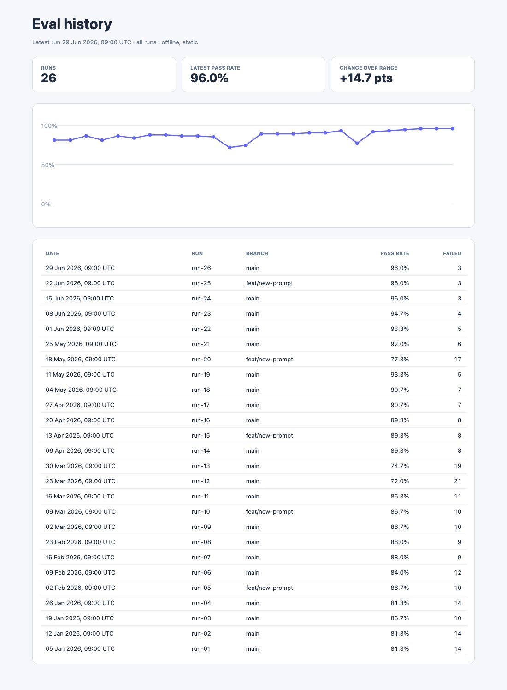

# History storage

`eval-dashboards history` builds a run-history timeline from your reports. By default it writes one `history.json` file. It can also write a SQLite file, which suits long histories.

## Choose a store

The store comes from the output file extension.

| Output path | Store |
|---|---|
| `history.json` (or any other extension) | JSON file. Default. Works on Node 20+. |
| `.sqlite`, `.sqlite3`, `.db` | SQLite file. Needs Node 22.5 or newer. |

```sh
eval-dashboards history --input=.evals_output --out=eval-report/history.sqlite
```

## Convert between stores

`history-convert` copies history from one store to the other. It replaces whatever the output file already held.

```sh
# import history.json into SQLite
eval-dashboards history-convert --input=eval-report/history.json --out=eval-report/history.sqlite

# export SQLite back to history.json
eval-dashboards history-convert --input=eval-report/history.sqlite --out=eval-report/history.json
```

Converting in either direction gives byte-identical `history.json` output.

## Long-range trend report

`history-report` reads any store, filters it, and writes a static HTML trend page: a pass-rate chart plus a table of runs.

```sh
eval-dashboards history-report --input=eval-report/history.sqlite \
  --since=2026-01-01 --until=2026-06-30 --branch=main --suite=safety \
  --out=eval-report/history-trend.html
```

| Flag | Effect |
|---|---|
| `--since`, `--until` | Keep runs inside an ISO date range. A date with no time, such as `2026-06-30`, covers that whole day in `--until` |
| `--branch` | Keep runs from one branch |
| `--suite` | Keep runs that include the suite. The chart then uses that suite's own pass rate |
| `--keep-last` | Retention: keep only the newest N runs |
| `--max-age-days` | Retention: drop runs older than N days |
| `--prune-to` | Write the retained history to a file (JSON or SQLite) |
| `--locale` | BCP 47 locale tag for dates on the page, such as `en-GB` (default) or `de-DE` |

Retention applies before the query. `--prune-to` writes the retained history, not only the matching runs, so a branch filter never deletes other branches' history. The page is built offline and needs no server.



Regenerate these images with `pnpm assets:regenerate`. The input runs come from `scripts/generate-history-fixture.ts`, which is deterministic.

## Reading the trend page

- **Runs**: how many runs match your filters, after retention.
- **Latest pass rate**: the pass rate of the newest matching run.
- **Change over range**: newest pass rate minus oldest pass rate, in percentage points.
- **Chart**: one dot per run, oldest on the left. Dots are evenly spaced, not placed by date, so a missing week does not show as a gap. A run can be absent because a filter excluded it or retention dropped it. Hover a dot to see its run id.
- **Table**: the same runs, newest first.

## Duplicate run ids

Each artifact needs a unique `run.id`. If two files share one, `history` and `report` stop with exit code 2 and write nothing: `Duplicate run ID "r1" in a.json and b.json.` Rename one run and re-run.

## Keep history across CI builds

`history` rebuilds the history from the artifact files in `--input` and replaces the output file. It does not add to an existing history. So the thing to keep between builds is the folder of run artifacts, not only the history file. If an artifact leaves `--input`, its run leaves the history.

A fresh build agent starts with an empty folder. Restore the artifacts, add the new run, then rebuild. This example uses the GitHub Actions cache; any artifact store works the same way.

```yaml
- uses: actions/cache@v4
  with:
    path: .evals_output
    key: eval-runs-${{ github.run_id }}
    restore-keys: eval-runs-
# ... your eval step writes this build's artifact into .evals_output ...
- run: npx eval-dashboards history --input=.evals_output --out=eval-report/history.sqlite
```

SQLite needs Node 22.5 or newer. On older Node, write `eval-report/history.json` instead. A SQLite file is not encrypted; protect it with disk or volume encryption if it holds sensitive data.

To drop old runs on purpose, use `history-report --keep-last` or `--max-age-days` with `--prune-to`. See "Long-range trend report" above.

## Keep history.json for rollups

`org-rollup` and published static reports read `history.json` only. Export SQLite to `history.json` before using them.

## Node versions

SQLite uses the `node:sqlite` module built into Node. It is still marked experimental in Node 22 and prints an experimental warning. On Node 20 the SQLite store stops with a clear message. The JSON store and every other command are unaffected.

## SQLite layout

Each run is one row in `runs` holding the full entry as JSON. Date, branch and suite are separate indexed columns for range queries, and a `position` column keeps the order entries were written in, so runs with the same timestamp come back in the order you wrote them. The `meta` table records the `schemaVersion` (now 2). A file written by schema version 1 still reads; the next write upgrades it in place.

Several processes can write to one file. A writer waits up to 10 seconds for another to finish before it fails with `database is locked`.

## Adding another store

A store is an object with `read()` and `write(entries)` (the `HistoryStore` interface in `src/history/store.ts`). `createHistoryStoreForPath` picks the store from the path. `createHistoryStoreForPath`, `createFileHistoryStore`, `createSqliteHistoryStore` and the `HistoryStore` type are exported from `@icodenet/eval-dashboards`.
